# ha-remote-card

[](https://www.home-assistant.io/integrations/marketplace/)
[](https://github.com/juju35/ha-remote-card/actions/workflows/hacs.yml)
[](https://github.com/juju35/ha-remote-card/actions/workflows/validate.yml)
[](https://github.com/juju35/ha-remote-card/actions/workflows/lint.yml)
[](https://github.com/juju35/ha-remote-card/releases/latest)
[](https://github.com/juju35/ha-remote-card/blob/main/LICENSE)
[](https://buymeacoffee.com/julienstep9)

<p align="center"></p>

<p align="center">
  &nbsp;&nbsp;
  &nbsp;&nbsp;
  &nbsp;&nbsp;
  &nbsp;&nbsp;
  &nbsp;&nbsp;
  &nbsp;&nbsp;
  &nbsp;&nbsp;
  &nbsp;&nbsp;
  
</p>

A Lovelace **remote control** for your TVs and streaming boxes in Home Assistant: a large round **D-pad** with OK, back, home and menu, **volume** and mute, **channels**, play / pause and previous / next, power, and a popup of **app shortcuts and sources** — with what is playing right in the header.

The card finds the TV's `remote` and `media_player` entities on the same device and detects the integration from them, then sends every key the way that integration expects it: a remote command, a service of the integration or a media player action. Any key can be remapped with `commands`.

[](https://my.home-assistant.io/redirect/marketplace_repository/?owner=juju35&repository=ha-remote-card&category=plugin)

| Remote Card | Remote Mini Card |
|---|---|
| 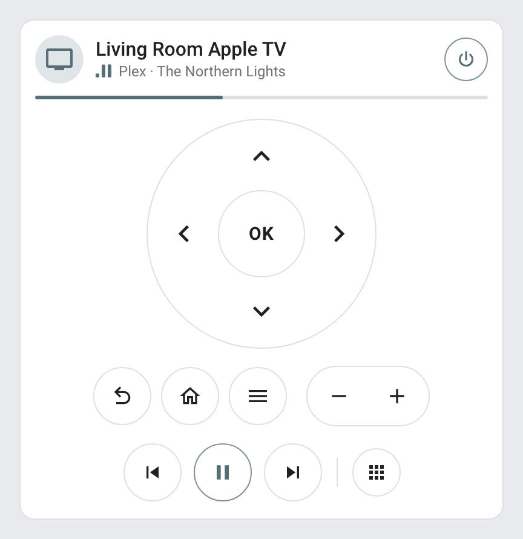 | 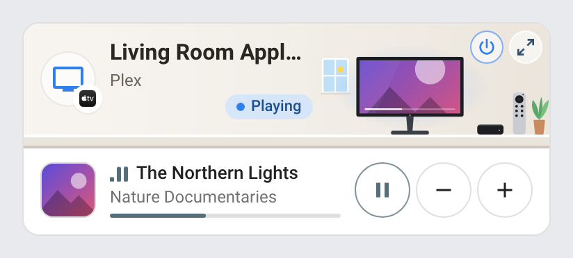 |

## Features

- Two cards: a full **Remote Card** (`custom:remote-card`) and a compact **Remote Mini Card** (`custom:remote-mini-card`)
- Header: the TV's name, **what is playing** (app · title, with dancing bars while it plays) and a progress bar, the **power** key on the right, outlined in the accent color while the TV is on
- Large round **D-pad**: up, down, left, right and OK; optional **swipe gestures** (swipe to move, tap to press)
- Back, home and menu keys on the same row as the **volume** rocker (− | mute | +, the mute key in the accent color while muted) when the card is wide enough, a **channel** rocker when the TV has channels, play / pause, previous and next
- Outlined keys, never filled: the accent color rings the key pressed or active
- **Sources and apps** button: a popup at the top of the card with your **app shortcuts** (a source, an Android TV activity or app link, a remote command or any action) and the **sources** of the player; the current one is highlighted
- **Long press repeats** the direction, volume and channel keys; **haptic feedback** on every key sent (Home Assistant companion app)
- Keys the TV does not have, or its player does not support, are hidden
- **`commands`**: remap any key to another command, a list of commands, or any Home Assistant action, or hide it
- Mini card: power and the **detail button** side by side at the top right, what is playing (artwork, title, progress), play / pause and volume; the detail button unfolds the full remote, and a click anywhere outside the card folds it back
- Click the name or what is playing to open the more-info dialog of the player
- Visual editor in the dashboard UI for both cards (no YAML needed, except `apps` and `commands`)
- Sections view: the full card takes 12 columns by default and at least 6, the mini card 6; narrow widths get their own layout
- Light and dark mode, `prefers-reduced-motion`, keyboard navigation, English, French, German, Spanish, Italian, Dutch, European Portuguese, Polish, Serbian (Cyrillic and Latin), Romanian, Danish, Swedish, Bulgarian, Russian, Ukrainian, Hungarian, Slovak, Czech, Slovenian, Latvian and Greek
- Single file, no external dependency

## Supported integrations

| Integration | Detected from | How the keys are sent |
|---|---|---|
|  [Apple TV](https://www.home-assistant.io/integrations/apple_tv/) (core, `apple_tv`) | `remote` + `media_player` | `remote.send_command`: `up`, `select`, `menu` (back), `home`, `top_menu` (menu), `volume_up`, `play_pause`, `previous`, `next`…; mute through the media player when it supports it (the Siri Remote has no mute key); no channel keys |
|  [Android TV Remote](https://www.home-assistant.io/integrations/androidtv_remote/) (core, `androidtv_remote`) — Google TV, NVIDIA Shield, Freebox Pop… | `remote` + `media_player` | `remote.send_command`: `DPAD_UP`, `DPAD_CENTER`, `BACK`, `HOME`, `MENU`, `VOLUME_UP`, `VOLUME_MUTE`, `CHANNEL_UP`, `MEDIA_PLAY_PAUSE`… |
|  [Philips TV](https://www.home-assistant.io/integrations/philips_js/) (core, `philips_js`) | `remote` + `media_player` | `remote.send_command`: `CursorUp`, `Confirm`, `Back`, `Home`, `Options` (menu), `VolumeUp`, `Mute`, `ChannelStepUp`, `PlayPause`… |
|  [Samsung Smart TV](https://www.home-assistant.io/integrations/samsungtv/) (core, `samsungtv`) | `remote` + `media_player` | `remote.send_command`: `KEY_UP`, `KEY_ENTER`, `KEY_RETURN`, `KEY_HOME`, `KEY_MENU`, `KEY_VOLUP`, `KEY_MUTE`, `KEY_CHUP`…; transport through the media player |
|  [LG webOS TV](https://www.home-assistant.io/integrations/webostv/) (core, `webostv`) | `media_player` | `webostv.button`: `UP`, `ENTER`, `BACK`, `HOME`, `MENU`, `VOLUMEUP`, `MUTE`, `CHANNELUP`…; transport through the media player |
|  [Roku](https://www.home-assistant.io/integrations/roku/) (core, `roku`) | `remote` + `media_player` | `remote.send_command`: `up`, `select`, `back`, `home`, `info` (menu), `volume_up`, `volume_mute`, `channel_up`, `play`… |
|  [Android Debug Bridge](https://www.home-assistant.io/integrations/androidtv/) (core, `androidtv`) — Fire TV, Android boxes | `media_player` | `androidtv.adb_command`: `UP`, `CENTER`, `BACK`, `HOME`, `MENU`, `VOLUME_UP`, `MUTE`, channel key events…; transport through the media player |
|  [Freebox Player](https://github.com/Pouzor/freebox_player) (custom, `freebox_player`) — Révolution, Delta, mini 4K | `integration: freebox_player` (no entity) | `freebox_player.remote`: `up`, `ok`, `back`, `home`, `options` (menu), `vol_inc`, `mute`, `prgm_inc`, `play`, `power`… |
|  [Kodi](https://www.home-assistant.io/integrations/kodi/) (core, `kodi`) | `media_player` | `kodi.call_method`: `Input.Up`, `Input.Select`, `Input.Back`, `Input.Home`, `Input.ContextMenu` (menu); volume, mute and transport through the media player |
| Any other media player | `media_player` | Power, volume, mute, play / pause, previous and next through the media player; add the other keys with `commands` |

Power turns the TV on or off from its current state, through the media player when it supports it, else the remote (a Philips TV is turned on by its remote). Volume, mute, play / pause, previous and next sent through the media player are shown only when the player supports them.

The **Freebox Pop** is an Android TV: use the Android TV Remote integration. The Freebox Player custom integration has no entity: set `integration: freebox_player` (and a `title`).

## Prerequisites

Home Assistant 2024.8 or later, with one of the integrations above configured for your TV or box.

## Installation

### Via the Marketplace (recommended)

Click the button below to add the repository directly:

[](https://my.home-assistant.io/redirect/marketplace_repository/?owner=juju35&repository=ha-remote-card&category=plugin)

Then click **Install**, and reload your browser when the Marketplace asks you to.

Or manually:

1. Open **Settings → Marketplace → Add from link** (top right; this needs a GitHub account connected)
2. Add `https://github.com/juju35/ha-remote-card` — Type: **Dashboard**
3. Open **Remote Card** and click **Install**
4. Clear your browser cache and refresh

The Marketplace adds the resource `/local/community/ha-remote-card/remote-card.js` for you.

### Manual

1. Download `remote-card.js` and the `remote-card.i18n.*.js` translation files from the [latest release](https://github.com/juju35/ha-remote-card/releases/latest)
2. Copy them all to `/config/www/` (without the translation files, the cards show in English)
3. Go to **Settings → Dashboards → ⋮ → Resources** → Add resource:
   - URL: `/local/remote-card.js`
   - Type: **JavaScript Module**
4. Clear your browser cache and refresh

## Configuration

### Card types

| Card | Type |
|---|---|
| Remote Card | `custom:remote-card` |
| Remote Mini Card | `custom:remote-mini-card` |

### Visual editor

Edit a dashboard, click **Add card** and search for **Remote Card** or **Remote Mini Card**. The first TV remote is preselected; pick another remote or media player, force the integration if needed, set an optional title and choose the keys to show. The preview updates live, and options left at their default are kept out of the generated YAML. `apps` and `commands` are set in YAML.

### Minimal

```yaml
type: custom:remote-card
entity: remote.living_room_apple_tv
```

```yaml
type: custom:remote-mini-card
entity: remote.living_room_apple_tv
```

### Full options

```yaml
type: custom:remote-card
entity: remote.living_room_apple_tv
media_player: media_player.living_room_apple_tv
title: Living room
illustration_theme: auto
show_channels: false
swipe: true
apps:
  - name: YouTube
    icon: mdi:youtube
    source: YouTube
  - name: Netflix
    icon: mdi:netflix
    source: Netflix
  - name: Kids
    activity: https://www.example.com/kids
  - name: Movie night
    icon: mdi:movie-open
    action: script.turn_on
    data:
      entity_id: script.movie_night
commands:
  menu: top_menu
  mute:
    action: script.turn_on
    target:
      entity_id: script.soundbar_mute
language: fr
```

```yaml
type: custom:remote-mini-card
integration: freebox_player
title: Freebox
zoom: true
```

### Options reference

| Option | Card | Default | Description |
|---|---|---|---|
| `entity` | both | First TV remote | `remote` entity of the TV or box (or its `media_player` when it has no remote) |
| `media_player` | both | Same device | Media player shown (what is playing, sources, volume, power state); found on the remote's device when left out |
| `integration` | both | Detected | Forces the key mapping: `apple_tv`, `androidtv_remote`, `philips_js`, `samsungtv`, `webostv`, `roku`, `androidtv`, `freebox_player`, `kodi` or `generic` (media player only) |
| `title` | both | Device name | Card title |
| `illustration` | both | `true` | Illustrated header: a living room with the TV, the integration's box and remote on a shelf; the screen shows the state (off, home screen, what is playing, paused). `false` keeps the classic header |
| `illustration_theme` | both | `auto` | `day`, `night`, or `auto` (follows the Home Assistant theme: night with a dark theme, day with a light theme) |
| `show_title` | both | `true` | Show the title in the header |
| `show_subtitle` | both | `true` | Show what is playing (or the state) under the title, and the progress bar |
| `show_power` | both | `true` | Power key |
| `show_volume` | both | `true` | Volume rocker and mute |
| `show_channels` | both | `true` | Channel rocker (when the integration has channel keys) |
| `show_transport` | both | `true` | Play / pause, previous and next |
| `show_sources` | both | `true` | Sources of the player in the popup |
| `show_apps` | both | `true` | App shortcuts (`apps`) in the popup |
| `haptic` | both | `true` | Haptic feedback on every key sent |
| `repeat` | both | `true` | Long press repeats the direction, volume and channel keys |
| `swipe` | both | `false` | Swipe gestures on the D-pad: swipe to move, tap to press the key under the finger |
| `zoom` | mini | `true` | Detail button at the top right of the mini card: it unfolds the full remote (with the same options, so the full card's options can be set on the mini card too) and folds it back; a click outside the card also folds it back. `false` removes the button |
| `apps` | both | — | **YAML only.** App shortcuts in the popup, see [Apps](#apps) |
| `commands` | both | — | **YAML only.** Key overrides, see [Commands](#commands) |
| `language` | both | Auto | Force language: `en`, `fr`, `de`, `es`, `it`, `nl`, `pt`, `pl`, `sr`, `sr-Latn`, `ro`, `da`, `sv`, `bg`, `ru`, `uk`, `hu`, `sk`, `cs`, `sl`, `lv` or `el` (auto-detects from HA settings) |

### Apps

Each shortcut has a `name`, an optional `icon` (`mdi:…`; the first letter of the name otherwise) and one of:

| Key | What it does |
|---|---|
| `source` | `media_player.select_source` on the player (highlighted while it is the current source or app) |
| `activity` | `remote.turn_on` with this activity: an app package or app link on Android TV Remote |
| `command` | `remote.send_command` with this command (or list of commands) |
| `action` (+ `data`, `target`) | Any Home Assistant action |

### Commands

`commands` maps a key to what it sends instead of the integration's own: a remote command (`menu: top_menu`), a list of remote commands (`home: [home, home]`), an action (`{ action: script.turn_on, data: {…}, target: {…} }`, sent to the media player when it has no target and is not a script, scene or automation), or `null` to hide the key. A key the integration lacks appears once it has a command.

Keys: `power`, `up`, `down`, `left`, `right`, `ok`, `back`, `home`, `menu`, `volume_up`, `volume_down`, `mute`, `channel_up`, `channel_down`, `play_pause`, `previous`, `next`.

## Screenshots

### Cards

The full card of an Apple TV playing in Plex, and of a Philips TV on live TV (its channel rocker and mute key):

| | Apple TV | Philips TV |
|---|---|---|
| Light |  | 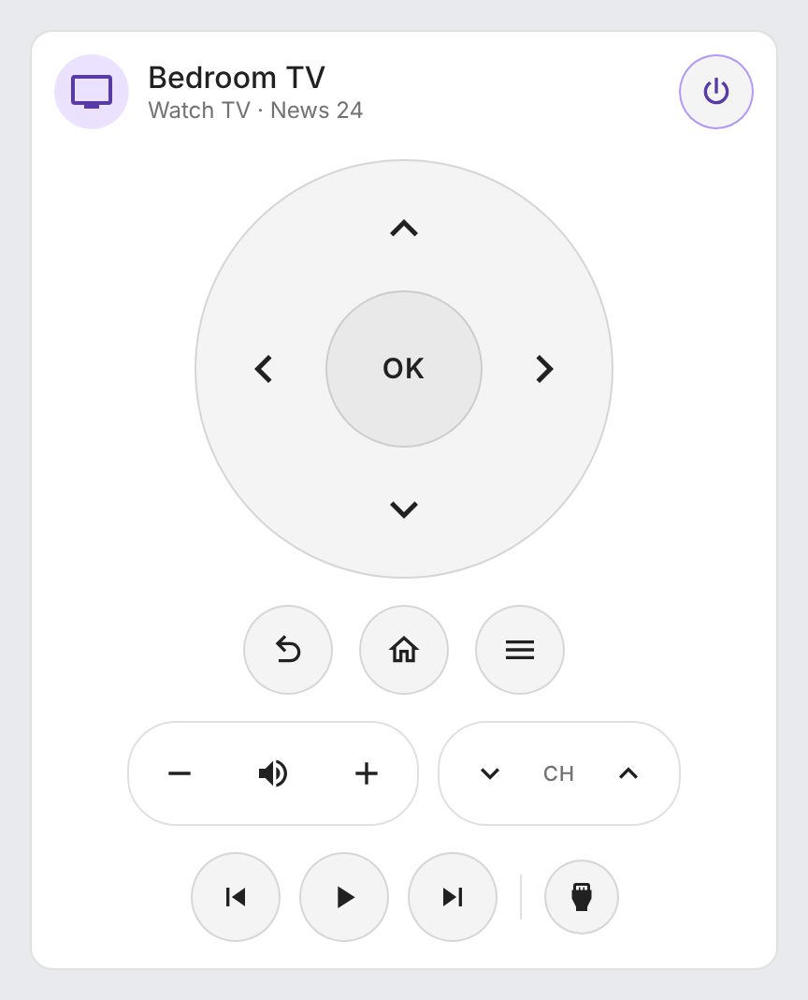 |
| Dark | 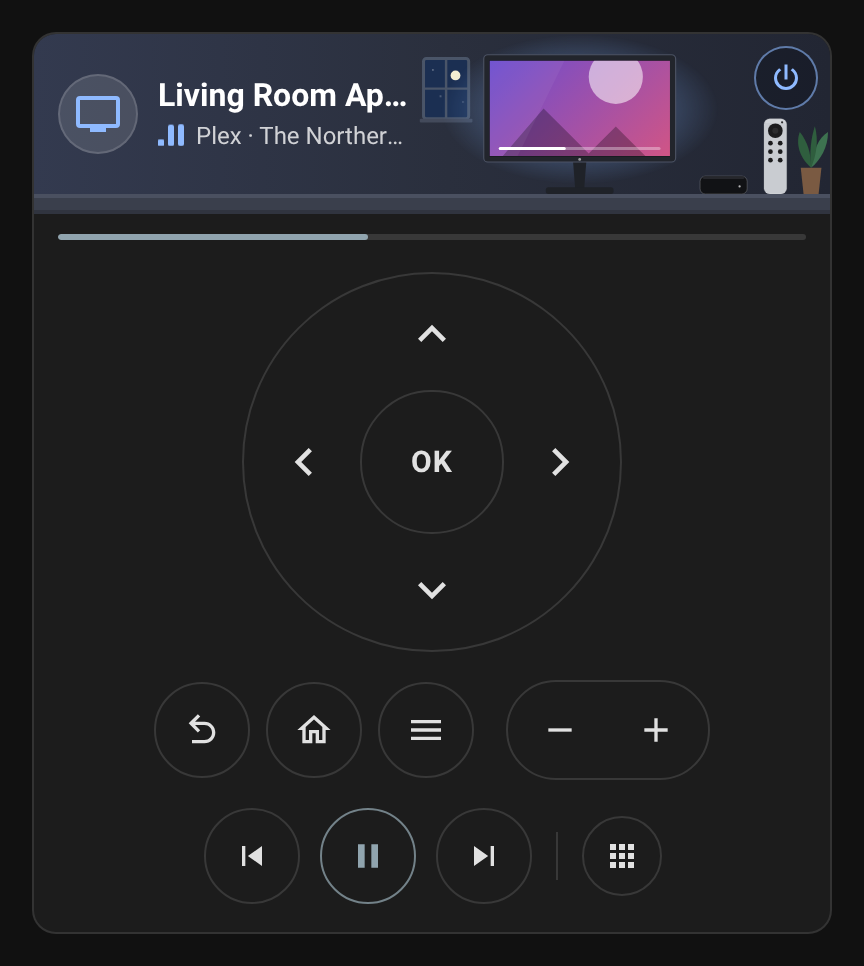 | 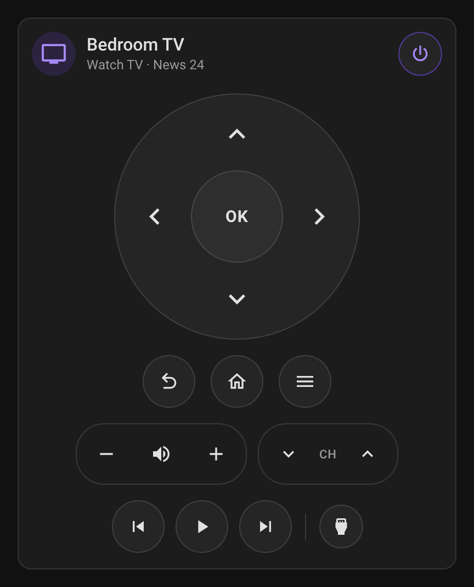 |

The sources and apps popup, at the top of the card (the app playing highlighted), and an NVIDIA Shield through Android TV Remote:

| | Sources and apps | Android TV |
|---|---|---|
| Light | 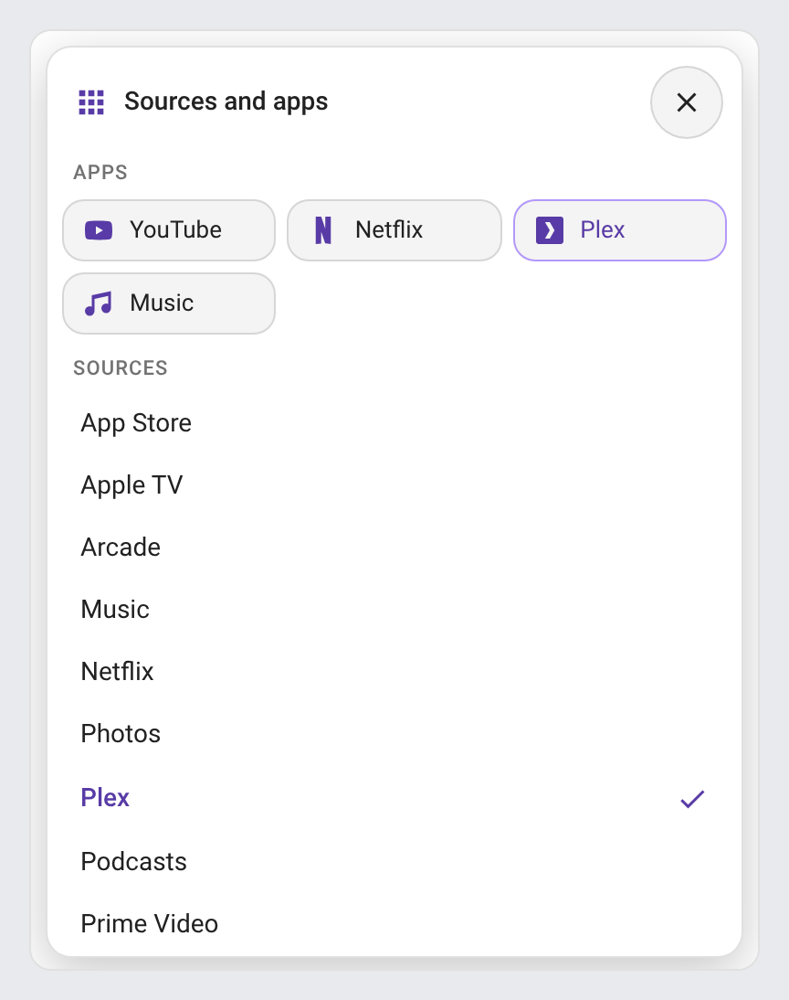 | 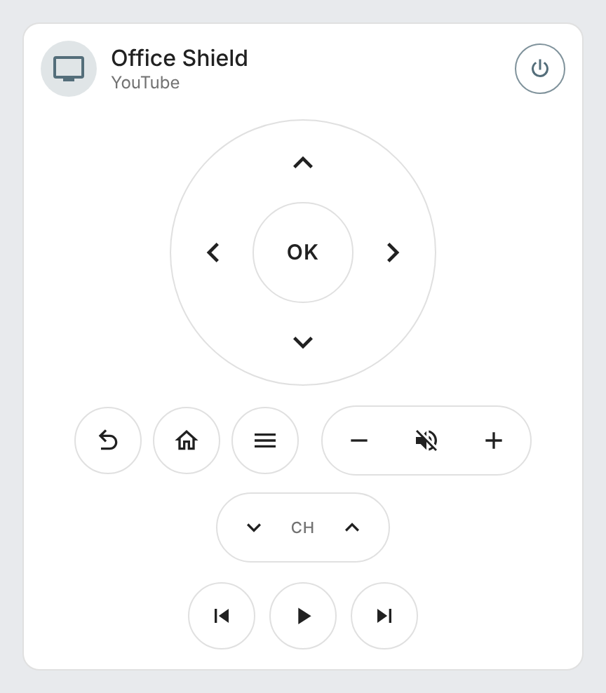 |
| Dark | 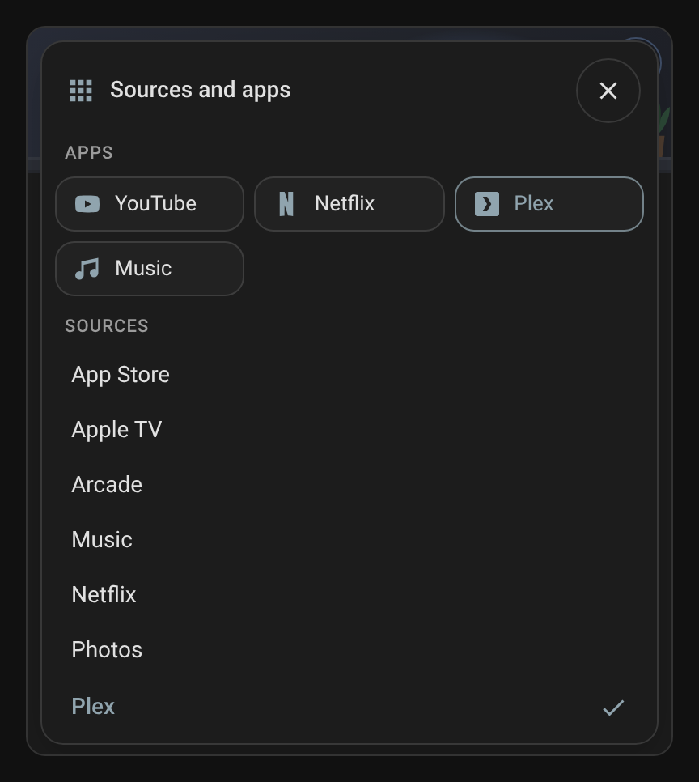 | 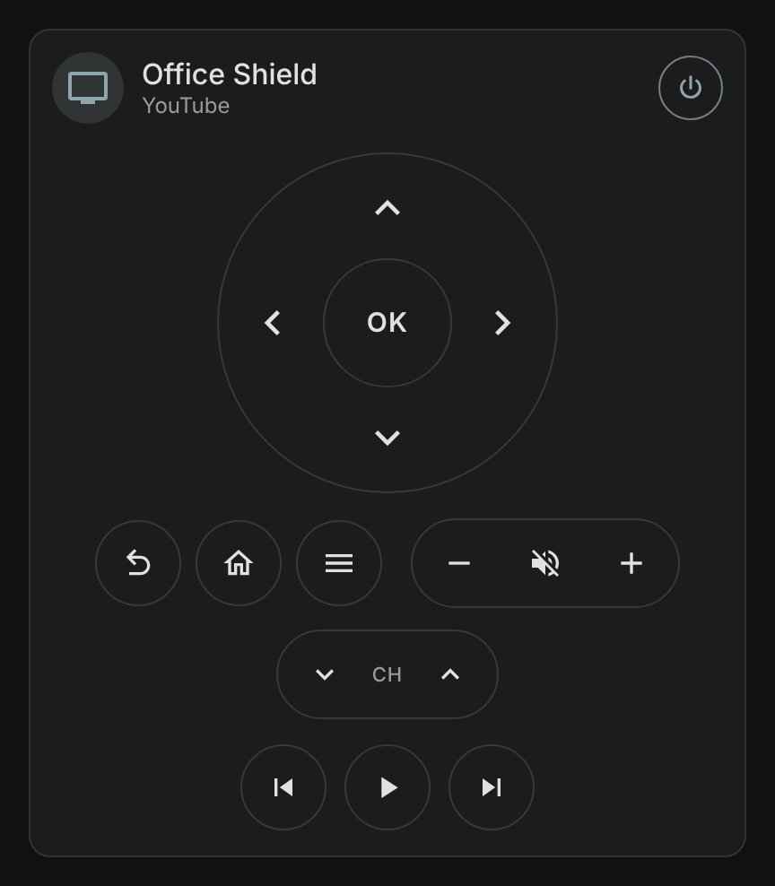 |

The mini card, and its detailed view after a click on the detail button:

| | Apple TV | Philips TV |
|---|---|---|
| Light |  | 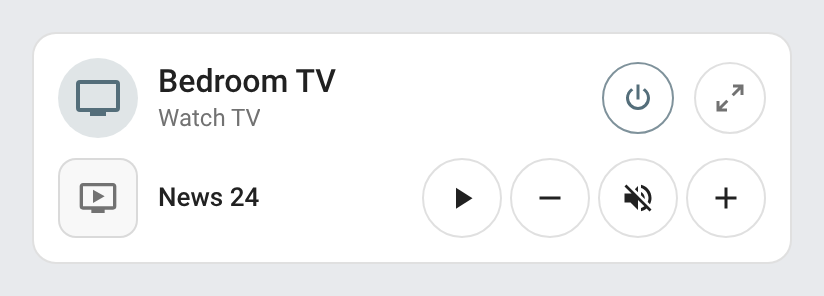 |
| Dark | 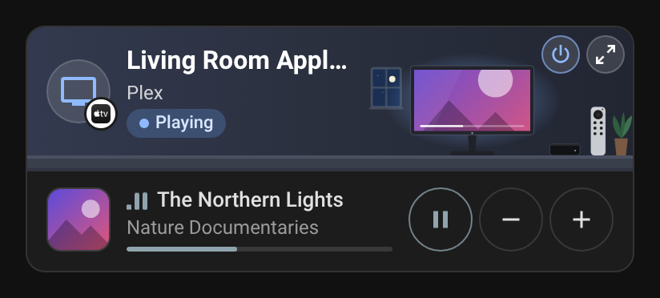 | 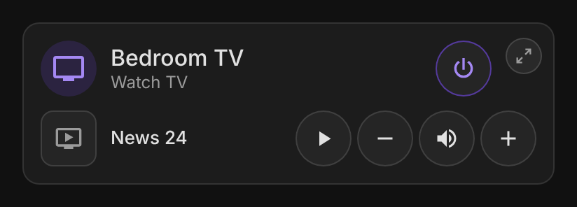 |

| Detail view, light | Detail view, dark |
|---|---|
| 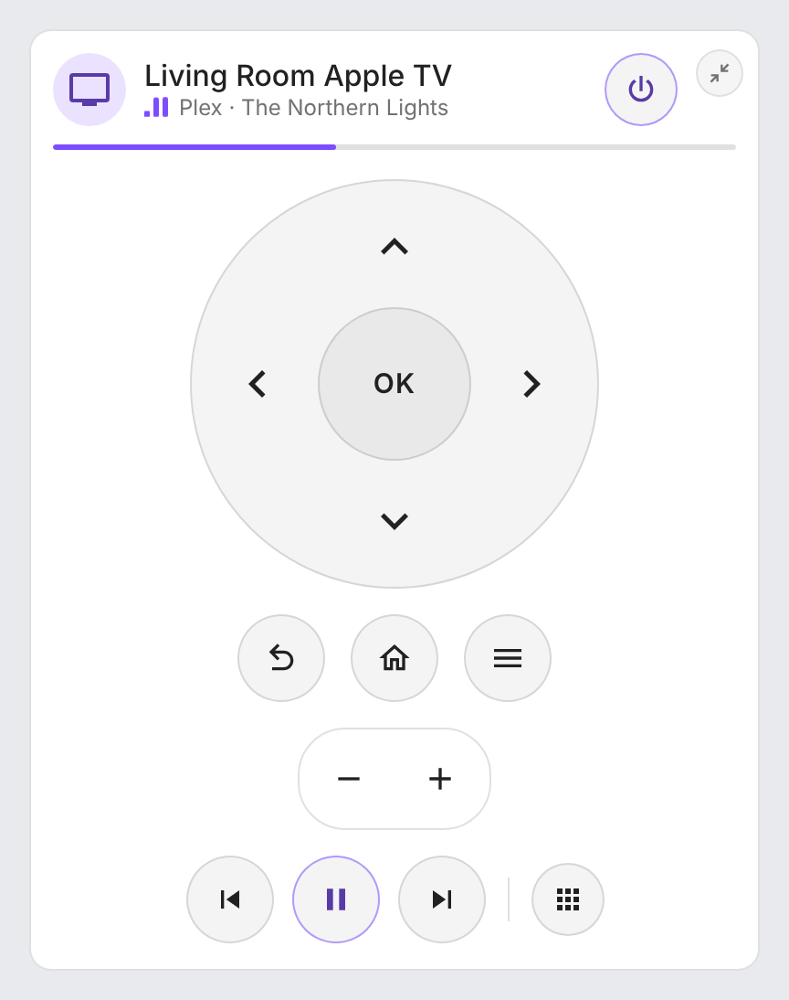 | 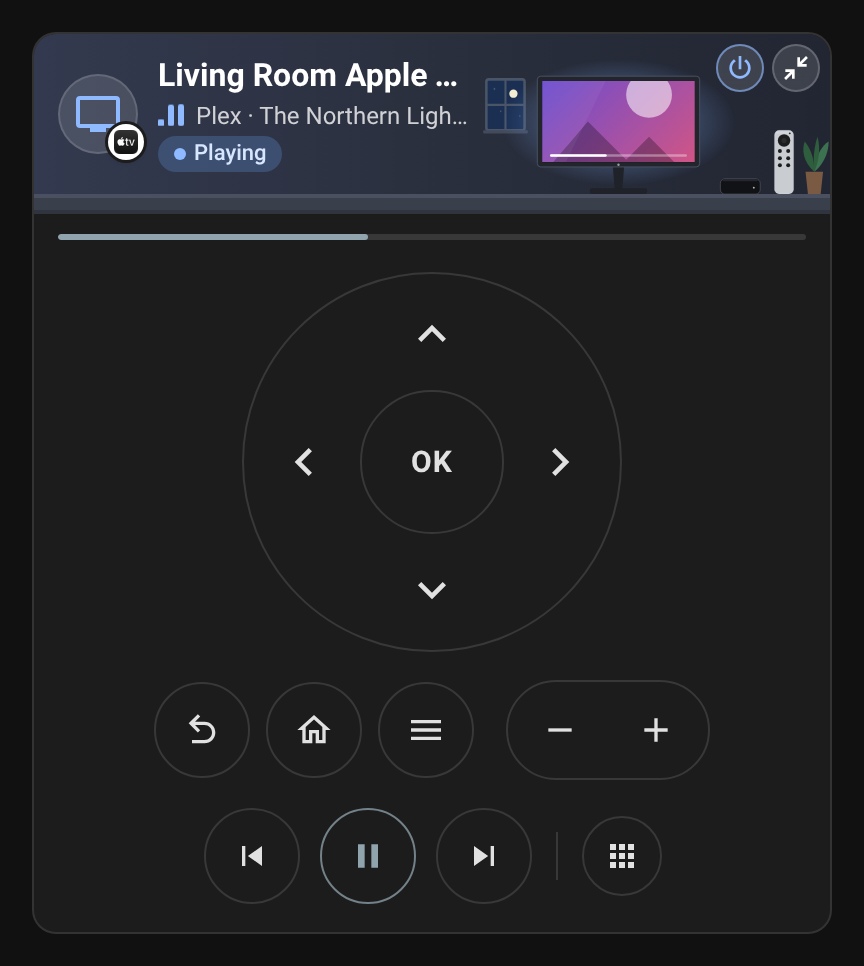 |

Narrow widths: the full card at 238 px (back / home / menu, volume and channels each on their own line) and the mini card at 170 px (the artwork and the volume give way, the power key moves next to play / pause):

| | Full card | Mini card |
|---|---|---|
| Light | 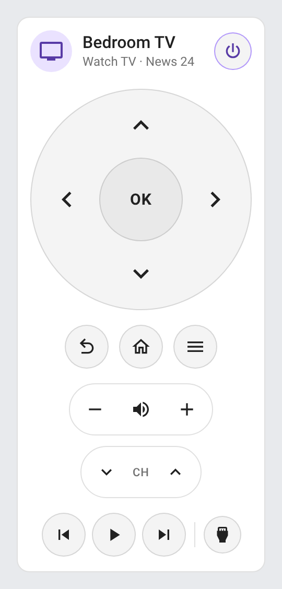 | 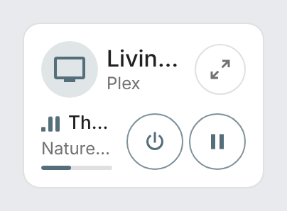 |
| Dark | 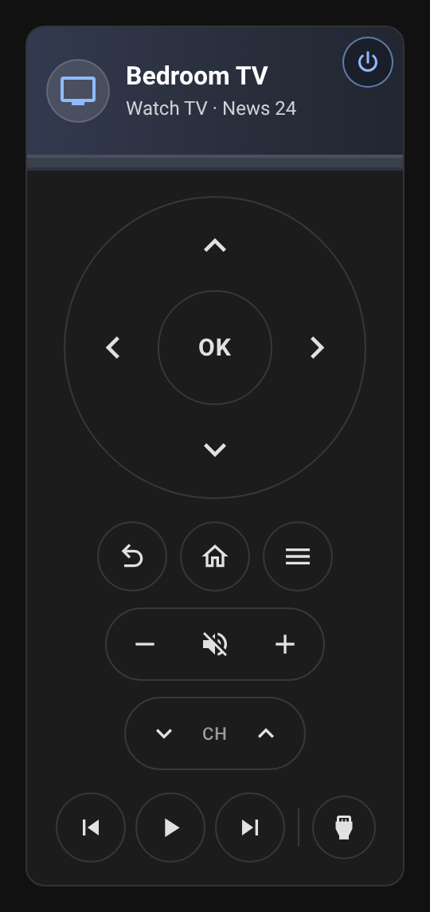 | 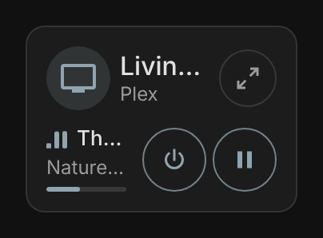 |

### Animation

While the TV plays, three bars dance next to what is playing and the progress bar moves on between two updates of Home Assistant; they stop when it is paused, and honour `prefers-reduced-motion`. In the illustrated header the picture pans on the TV's screen, the TV's light breathes on the wall and the remote sends its signal:

| Light | Dark |
|---|---|
| 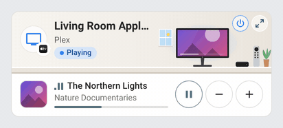 | 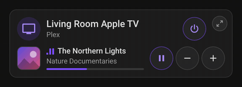 |

## How it works

The card reads the Home Assistant entity and device registries: the `remote` and the `media_player` of the same device are paired (give either one), and the integration is the platform of the remote, else of the player. Unless `integration` is set, a player of an integration the card does not know gets the media player keys only.

A key is pressed on the pointer press, not at the release, so the remote feels immediate; the direction, volume and channel keys are sent again every 180 ms after a 450 ms hold while `repeat` is on. With `swipe`, a press on the D-pad waits: moving the finger by 28 px sends the direction (again for each further 28 px), a tap sends the key under it, a hold repeats it. The card is not redrawn while a key is held, so the key keeps its pressed look, and updates are patched into the page in place so that the animations do not restart.

## Development

```bash
npm install
npm run build        # copies src/remote-card.js into dist/remote-card.js (translations split into dist/remote-card.i18n.*.js)
npm run check        # builds and checks the card (run in CI)
npm test             # unit tests (node --test)
npm run screenshots  # renders the cards (and the GIF, needs ffmpeg) with mock data into screenshots/
```

`dist/` is not committed: `npm run build` creates it locally, CI builds it on every push, and the release workflow attaches the built files to the release, which is where the Marketplace installs it from. The **Screenshots** workflow re-renders the captures on every pull request that touches the card and commits them to the pull request's branch when a pixel changed.

### Releasing

1. Bump `version` in `package.json` (and `package-lock.json` with `npm install`)
2. Add a `## <version>` section at the top of [CHANGELOG.md](https://github.com/juju35/ha-remote-card/blob/main/CHANGELOG.md)
3. Push to `main`: the **Release** workflow builds the card, creates the tag and the GitHub release with the changelog section as notes, and attaches `remote-card.js` and its translation files

## Translations

The cards auto-detect the language from your Home Assistant settings. Currently supported:

| Language | Code |
|---|---|
| English | `en` |
| Français | `fr` |
| Deutsch | `de` |
| Español | `es` |
| Italiano | `it` |
| Nederlands | `nl` |
| Português (European; also used for `pt-BR`) | `pt` |
| Polski | `pl` |
| Српски | `sr` |
| Srpski (latinica) | `sr-Latn` |
| Română | `ro` |
| Dansk | `da` |
| Svenska | `sv` |
| Български | `bg` |
| Русский | `ru` |
| Українська | `uk` |
| Magyar | `hu` |
| Slovenčina | `sk` |
| Čeština | `cs` |
| Slovenščina | `sl` |
| Latviešu | `lv` |
| Ελληνικά | `el` |

Contributions for additional languages are welcome!

## Credits

The integration logos come from the [Home Assistant brands](https://github.com/home-assistant/brands) repository; they are trademarks of their owners. This project is not affiliated with Apple, Google, Philips, Samsung, LG, Roku, Amazon, Free, the Kodi Foundation or the authors of these integrations.

## License

[MIT](https://github.com/juju35/ha-remote-card/blob/main/LICENSE)

## Support

If you find this project useful, you can support its development:

<a href="https://buymeacoffee.com/julienstep9"></a>
